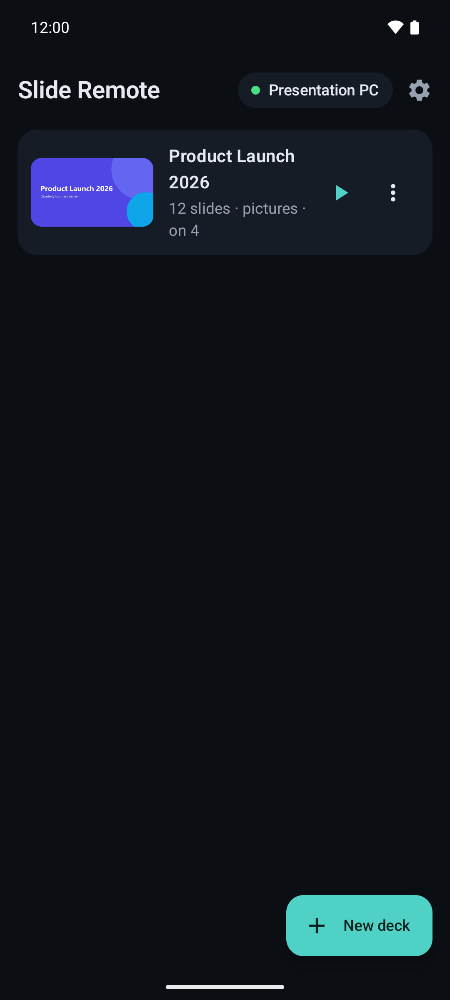
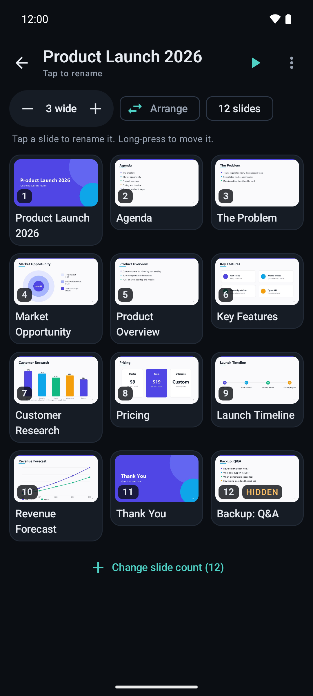
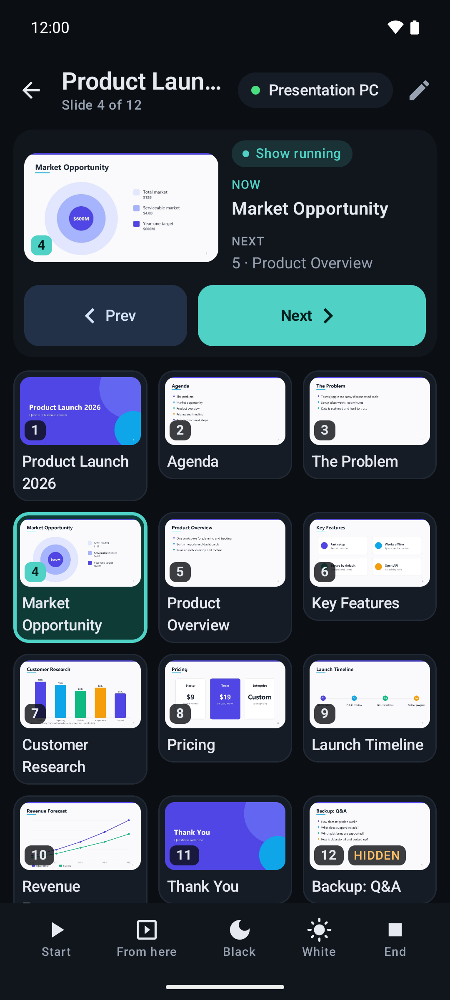
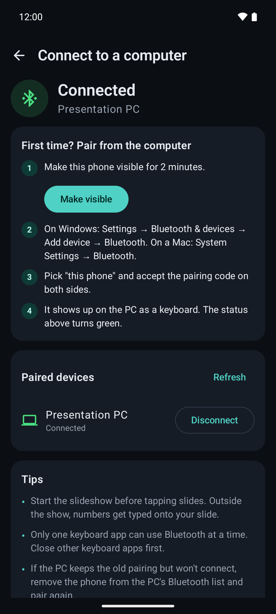
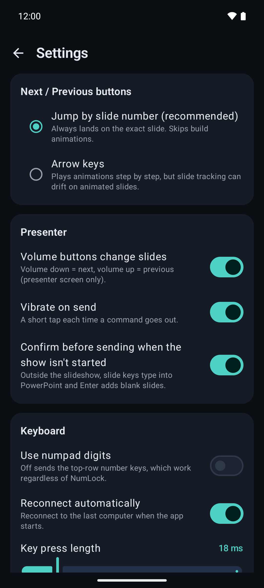
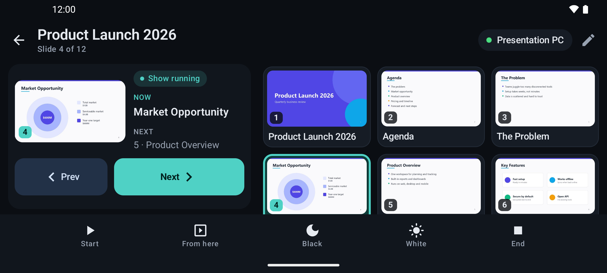

# Slide Remote

An Android app that turns your phone into a Bluetooth keyboard for PowerPoint. Lay your slides out on a grid, tap one, and the presentation jumps straight to it.

Like other Bluetooth keyboard apps, the phone pairs with the PC as an ordinary Bluetooth keyboard, so **nothing gets installed on the computer**. During a slideshow, PowerPoint jumps to any slide when you type its number and press Enter. That's what each tile sends.

> Not affiliated with or endorsed by Microsoft. PowerPoint is a trademark of Microsoft Corporation.

## Screenshots

<table>
  <tr>
    <td></td>
    <td></td>
    <td></td>
  </tr>
  <tr>
    <td></td>
    <td></td>
    <td></td>
  </tr>
</table>



The sample deck is generated by `tools/make_demo_pdf.py`. Debug builds launched with `adb shell am start -n com.toxicorca.slideremote/.MainActivity --ez demo true` fake a connected PC and seed that deck.

## Features

- **Decks**: name the deck, set how many slides, name each slide, lay them out on a 1–6 column grid, and swap tiles to arrange them however you like.
- **Import a .pptx**: reads slide count, slide titles and hidden slides automatically. Hidden slides get a **HIDDEN** badge on their tile.
- **Import a PDF export**: renders each page as a tile picture. Add a PDF to a .pptx-imported deck to get pictures *and* titles. PowerPoint leaves hidden slides out of PDFs by default; the app detects that and matches pictures to the visible slides.
- **Presenter**:
  - Tap a tile to jump.
  - Big Prev / Next buttons. Next and Prev skip hidden slides, just like PowerPoint.
  - "Now / Next" panel with the current slide's picture.
  - Start (F5), From here (F5, then jump to the current slide), Black (B), White (W), End (Esc).
  - **Show-running guard**: if the app thinks the slideshow hasn't started, it asks before sending slide keys (which would otherwise type into your slides). Choose **Start show here**, **It's already running**, or **Cancel**. Tap the "Show running / Show not started" chip to correct it. Can be turned off in Settings.
  - Volume buttons change slides (optional).
  - Screen stays awake while presenting.
  - Landscape layout puts the panel beside the grid.
- **Slide tracking**: the app remembers the last slide it sent, per deck, across restarts. If you move with the mouse or a clicker, long-press the right tile and choose **Mark as current**.
- **Connection**: pairing walkthrough, paired-device list, auto-reconnect to the last PC, and a foreground service that keeps the link alive with the screen off.
- **Open with**: share or open a .pptx / .pdf from another app straight into a new deck.
- **Settings**: jump-by-number or arrow-key stepping, numpad digits, key press length, slideshow open delay, vibrate on send.
- Dark theme only.

## Download

Prebuilt APKs are published on the [GitHub Releases](../../releases) page.

## Building

Requirements: Android Studio (Ladybug or newer) and JDK 17–21 (Android Studio's bundled JBR works; Gradle 8.14.3 doesn't run on JDK 25).

1. Open the project folder in Android Studio and let Gradle sync. It downloads Gradle 8.14.3, AGP 8.10.1, Kotlin 2.1.21 and the Compose libraries.
2. Build a debug APK from the command line with:

   ```
   ./gradlew assembleDebug      # macOS / Linux
   gradlew.bat assembleDebug    # Windows
   ```

   The APK lands in `app/build/outputs/apk/debug/`.
3. Run on a real phone running Android 9 or newer. The emulator has no Bluetooth HID.

## First run

1. Open the app, then tap the status pill (top right) → **Allow** (Nearby devices permission).
2. Tap **Make visible**.
3. On the PC, go to Settings → Bluetooth & devices → Add device → Bluetooth, and pick your phone.
4. Once the status pill is green, import or create a deck, start the slideshow (the **Start** button sends F5), and tap away.

## Things to know

- **Start the slideshow first.** Outside the show, the digits get typed into your slide.
- **One keyboard app at a time.** Android only lets one app be a Bluetooth HID device. Close other Bluetooth keyboard apps before using this.
- **Some phones don't support it.** A few manufacturers disable the HID Device profile. The app detects this and says so.
- **Old .ppt files** aren't supported. Save as .pptx first.
- **Numpad vs top-row digits.** Top-row digits are the default because they don't depend on NumLock. They do depend on the PC's keyboard layout, though: on AZERTY (French, Belgian) layouts the top row types symbols unless Shift is held, so slide jumps won't work. On those PCs, turn on **Use numpad digits** in Settings (and make sure NumLock is on).
- **Animations.** Next/Prev default to jumping by slide number, which is exact but skips build animations. Switch to arrow keys in Settings to step through animations; tracking may drift on animated slides.

## Project layout

```
app/src/main/java/com/toxicorca/slideremote/
  hid/        Bluetooth HID keyboard: descriptor, key codes, controller, foreground service
  data/       Deck model + JSON storage, settings
  importer/   .pptx reader, PDF renderer, page-to-slide mapping
  ui/         Compose screens (deck list, editor, presenter, connect, settings), theme
```

## License

Licensed under the [Apache License 2.0](LICENSE). Copyright 2026 ToxicOrca.
